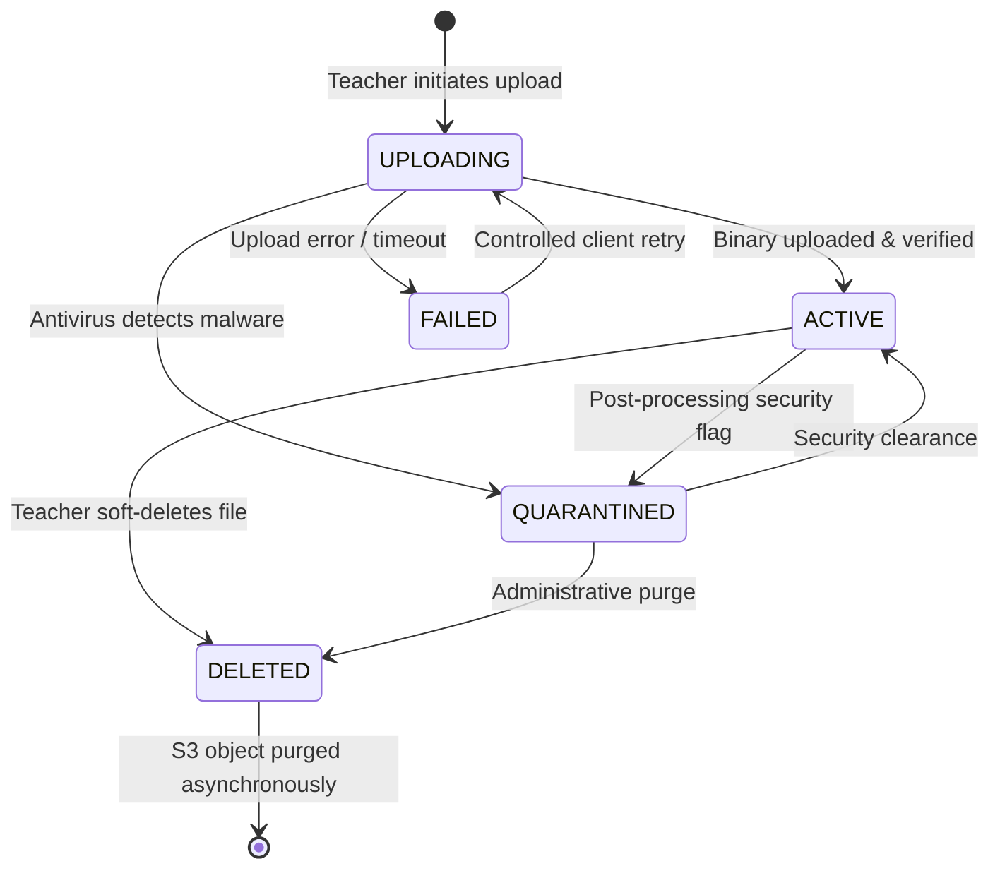

# Production Collection Specification: `lesson_plan_documents`

## 1. Executive Summary & Architecture Overview

The `lesson_plan_documents` collection is a specialized MongoDB metadata registry designed for the **Teacher Portal – Lesson Plan Management** module of the Thinkigen School ERP.

### System Boundaries and Data Ownership

| Subsystem | Primary Role & Responsibilities | Boundary Invariants |
| :--- | :--- | :--- |
| **SQL Server / Azure SQL** | **System of Record** for all relational entities: Schools, Branches, Academic Years, Teachers/Users, Classes, Sections, Subjects, and Relational Lesson Plans. | Owns relational integrity, foreign keys, and role-based permissions. |
| **MongoDB** | **Document Metadata Registry** only. Stores document IDs, syllabus hierarchy links, S3 storage keys, checksums, mime types, preview pointers, processing states, and audit trails. | **NEVER** stores raw binary content, base64 payloads, or presigned URLs. |
| **AWS S3** | **Physical File Storage** for attachments, PDFs, Office documents, multimedia, and generated preview thumbnails. | Stored in private, server-side encrypted S3 buckets with immutable object keys. |
| **FastAPI Backend** | **Application Controller**. Enforces RBAC permissions, coordinates upload sessions, validates file magic bytes, computes SHA-256 digests, and generates time-limited presigned S3 URLs. | MongoDB visibility flags **never** bypass FastAPI authorization. |

---

## 2. Complete Field Dictionary & Schema Specification

The collection is governed by a strict MongoDB `$jsonSchema` with `validationLevel: "strict"` and `validationAction: "error"`.

| Field | BSON Data Type | Nullable | Required | Relationship / Authoritative Source | Purpose & Description |
| :--- | :--- | :---: | :---: | :--- | :--- |
| `_id` | `objectId` | No | Auto | MongoDB Internal | Internal document primary key. Never exposed in external REST APIs. |
| `document_id` | `string` | No | Yes | FastAPI generated | Immutable public identifier with prefix `DOC-LP-` (e.g., `DOC-LP-2026-000001`). Unique across collection. |
| `tenant` | `object` | No | Yes | SQL Server | Strict multi-tenant isolation context. |
| `tenant.school_id` | `int`, `long` | No | Yes | SQL `schools.school_id` | Primary school tenant identifier (minimum: 1). |
| `tenant.branch_id` | `int`, `long` | No | Yes | SQL `branches.branch_id` | Operational branch identifier (minimum: 1). |
| `tenant.academic_year_id`| `int`, `long` | No | Yes | SQL `academic_years.year_id` | Active academic year identifier (minimum: 1). |
| `lesson_plan` | `object` | No | Yes | SQL Server | Parent lesson plan relational binding. |
| `lesson_plan.lesson_plan_id` | `int`, `long`, `string` | No | Yes | SQL `lesson_plans.lesson_plan_id` | Authoritative SQL primary key of the lesson plan. |
| `lesson_plan.teacher_id` | `int`, `long` | No | Yes | SQL `teachers.teacher_id` | Authoritative teacher identifier owning this lesson plan. |
| `academic_scope` | `object` | No | Yes | SQL / Curriculum Hierarchy | Pedagogical classification of the attached material. |
| `academic_scope.class_id` | `int`, `long` | No | Yes | SQL `classes.class_id` | Academic class / grade level (mandatory). |
| `academic_scope.section_id` | `int`, `long`, `null` | Yes | Yes | SQL `sections.section_id` | Specific section. Set to `null` for class-wide lesson plans. |
| `academic_scope.subject_id` | `int`, `long`, `null` | Yes | Yes | SQL `subjects.subject_id` | Specific subject. Set to `null` for cross-subject materials. |
| `academic_scope.chapter_id` | `string`, `int`, `long`, `null` | Yes | Yes | `class_subject_syllabus` / SQL | Syllabus chapter reference (e.g., `"CH-04"`). |
| `academic_scope.topic_id` | `string`, `int`, `long`, `null` | Yes | Yes | `class_subject_syllabus` / SQL | Syllabus topic reference (e.g., `"TOP-01"`). Null for chapter-level resources. |
| `owner` | `object` | No | Yes | Entity Ownership | Explicit entity ownership descriptor. |
| `owner.entity_type` | `string` | No | Yes | Fixed Enum | Must strictly be `"LESSON_PLAN"`. |
| `owner.entity_id` | `int`, `long`, `string` | No | Yes | `lesson_plan.lesson_plan_id` | Must strictly match `lesson_plan.lesson_plan_id`. |
| `classification` | `object` | No | Yes | Educational Role | Categorization and functional role of the file. |
| `classification.category` | `string` | No | Yes | Fixed Enum | Must strictly be `"LESSON_PLAN"`. |
| `classification.sub_category` | `string`, `null` | Yes | No | Module refinement | Optional sub-type (e.g., `"LAB_EXPERIMENT_GUIDE"`, `"WORKSHEET"`). |
| `classification.attachment_type` | `string` | No | Yes | Enum | Allowed: `"RESOURCE"`, `"ATTACHMENT"`, `"REFERENCE"`, `"MEDIA"`. |
| `file` | `object` | No | Yes | Physical File Attributes | Validated file properties. |
| `file.original_name` | `string` | No | Yes | Client upload | Original user filename (1–255 chars). Retained for display/audit. |
| `file.extension` | `string` | No | Yes | Server normalized | Lowercase alphanumeric extension without dot (e.g., `"pdf"`, `"docx"`). |
| `file.mime_type` | `string` | No | Yes | Server detected | IANA MIME type verified by magic-byte inspection (e.g., `"application/pdf"`). |
| `file.size_bytes` | `int`, `long` | No | Yes | Binary byte length | Positive byte count (minimum: 1). |
| `file.checksum_sha256` | `string` | No | Yes | Cryptographic digest | Exact 64-character lowercase SHA-256 hexadecimal hash. |
| `storage` | `object` | No | Yes | AWS S3 | Stable storage pointer. |
| `storage.provider` | `string` | No | Yes | Fixed Enum | Must strictly be `"AWS_S3"`. |
| `storage.bucket` | `string` | No | Yes | AWS S3 Bucket | Target private S3 bucket name (3–63 chars). |
| `storage.object_key` | `string` | No | Yes | AWS S3 Object Key | Structured S3 key. Unique within bucket. |
| `storage.version_id` | `string`, `null` | Yes | No | S3 Version ID | Optional S3 object version id when bucket versioning is enabled. |
| `security` | `object` | No | Yes | Metadata Visibility | Visibility flag. |
| `security.visibility` | `string` | No | Yes | Enum | Allowed: `"PRIVATE"`, `"RESTRICTED"`, `"PUBLIC"`. Default: `"RESTRICTED"`. |
| `lifecycle` | `object` | No | Yes | State Machine | Document availability and soft-deletion tracking. |
| `lifecycle.status` | `string` | No | Yes | Enum | Allowed: `"UPLOADING"`, `"ACTIVE"`, `"FAILED"`, `"DELETED"`, `"QUARANTINED"`. |
| `lifecycle.deleted_at` | `date`, `null` | Yes | No | Server timestamp | Populated only when status is `DELETED`. |
| `lifecycle.deleted_by` | `int`, `long`, `null` | Yes | No | SQL `users.user_id` | Populated only when status is `DELETED`. |
| `uploaded_by` | `int`, `long` | No | Yes | SQL `users.user_id` | User ID of the teacher/staff who initiated the upload. |
| `updated_by` | `int`, `long`, `null` | Yes | No | SQL `users.user_id` | User ID of the user who last updated metadata. |
| `preview` | `object`, `null` | Yes | No | AWS S3 | Optional generated thumbnail/preview metadata. |
| `preview.available` | `bool` | No | When obj | Boolean flag | Indicates whether the preview exists in S3. |
| `preview.object_key` | `string` | No | When obj | AWS S3 Object Key | S3 key for preview image/thumbnail. |
| `preview.mime_type` | `string` | No | When obj | MIME Type | Preview MIME type (e.g., `"image/png"`, `"image/jpeg"`). |
| `processing` | `object`, `null` | Yes | No | Background Worker | Antivirus scanning, OCR, or preview generation state. |
| `processing.status` | `string` | No | When obj | Enum | Allowed: `"NOT_REQUIRED"`, `"PENDING"`, `"PROCESSING"`, `"COMPLETED"`, `"FAILED"`. |
| `processing.processed_at` | `date`, `null` | Yes | No | Server timestamp | Timestamp when processing concluded. |
| `processing.processor_version`| `string`, `null` | Yes | No | Worker version | Pipeline version string (e.g., `"doc-pipeline-v2.4"`). |
| `processing.error_code` | `string`, `null` | Yes | No | Diagnostic code | Error code if processing failed. |
| `storage_cleanup` | `object`, `null` | Yes | No | Async Worker | Soft-deleted / orphaned S3 object purge tracking. |
| `storage_cleanup.status` | `string` | No | When obj | Enum | Allowed: `"PENDING"`, `"COMPLETED"`, `"FAILED"`. |
| `storage_cleanup.attempts` | `int`, `long` | No | When obj | Integer counter | Retry counter (minimum: 0). |
| `storage_cleanup.last_attempt_at`| `date`, `null`| Yes | No | Server timestamp | Timestamp of most recent purge attempt. |
| `storage_cleanup.last_error` | `string`, `null` | Yes | No | Error log | Diagnostic message if S3 deletion encountered errors. |
| `created_at` | `date` | No | Yes | Server UTC | Record creation timestamp. |
| `updated_at` | `date` | No | Yes | Server UTC | Record last modification timestamp. |

---

## 3. Schema Invariants Enforced by MongoDB Validator

The validator evaluates six cross-field invariants using `$and` expressions:

1. **Owner-Lesson Plan Match Invariant**:
   `$expr: { $eq: ["$owner.entity_id", "$lesson_plan.lesson_plan_id"] }`
   Guarantees `owner.entity_id` is identical to `lesson_plan.lesson_plan_id`.

2. **Storage Provider Invariant**:
   `"storage.provider": "AWS_S3"`
   All documents must specify AWS S3 as the physical storage provider.

3. **Owner and Category Invariant**:
   `"owner.entity_type": "LESSON_PLAN"` and `"classification.category": "LESSON_PLAN"`
   Guarantees that files in this collection only belong to lesson plans.

4. **Curriculum Hierarchy Invariant**:
   `$or: [ { "academic_scope.topic_id": null }, { "academic_scope.chapter_id": { $ne: null } } ]`
   A topic-level attachment cannot exist without referencing its parent chapter.

5. **Deletion Audit Invariant**:
   - If `status != "DELETED"`, `deleted_at: null` and `deleted_by: null`.
   - If `status == "DELETED"`, `deleted_at: Date` and `deleted_by: int/long` (minimum 1).

---

## 4. AWS S3 Storage Conventions & Versioning

### S3 Object Key Architecture

Every object stored in S3 follows a predictable, collision-free, and partitionable path:

```text
lessons/{school_id}/{branch_id}/{academic_year_id}/{lesson_plan_id}/{document_id}/v{version}/{filename}
```

- `school_id`, `branch_id`, `academic_year_id`: Tenant folder hierarchy allowing bucket-level lifecycle policies per school.
- `lesson_plan_id`: Groups all files attached to the same lesson plan.
- `document_id`: Unique identifier preventing filename collisions across uploads.
- `v{version}`: Monotonically increasing integer version segment (e.g., `v1`, `v2`).
- `{filename}`: URL-safe sanitized filename.

### Versioning Rules
- S3 objects are **immutable**. Uploading a replacement file increments the version segment (`/v2/`) or creates a new document record.
- Overwriting S3 objects in-place is strictly prohibited.
- When AWS S3 bucket versioning is enabled, the S3-returned version token is persisted in `storage.version_id`.

---

## 5. Lifecycle State Machine & Cleanup Protocol



### Soft-Deletion and Asynchronous S3 Purge Protocol
1. Teacher soft-deletes file via FastAPI `DELETE /lesson-plans/{lesson_plan_id}/documents/{document_id}`.
2. FastAPI updates MongoDB metadata:
   - `lifecycle.status = "DELETED"`
   - `lifecycle.deleted_at = new Date()`
   - `lifecycle.deleted_by = current_user.user_id`
   - `storage_cleanup = { status: "PENDING", attempts: 0, last_attempt_at: null, last_error: null }`
3. Document is immediately hidden from active API queries. Presigned download URLs are disabled.
4. Background Celery/FastAPI worker queries `ix_lesson_plan_documents_storage_cleanup`:
   - Issues `DeleteObjectCommand` to AWS S3.
   - Upon successful S3 response, updates `storage_cleanup.status = "COMPLETED"`.
   - On error, increments `storage_cleanup.attempts`, logs `last_error`, and schedules backoff retry.
   - MongoDB document metadata is retained indefinitely for audit and compliance.

---

## 6. Workload Indexing Strategy

All 12 indexes follow the **Equality -> Sort -> Range (ESR)** principle:

| # | Index Name | Index Key Specification | Unique | Partial Filter Expression | Primary Use Case |
| :---: | :--- | :--- | :---: | :--- | :--- |
| **1** | `uq_lesson_plan_documents_document_id` | `{ document_id: 1 }` | **Yes** | None | Direct REST lookup by document_id. |
| **2** | `uq_lesson_plan_documents_bucket_object_key` | `{ "storage.bucket": 1, "storage.object_key": 1 }` | **Yes** | None | Enforces physical object key uniqueness in S3. |
| **3** | `ix_lesson_plan_documents_plan_status_created` | `{ "lesson_plan.lesson_plan_id": 1, "lifecycle.status": 1, created_at: -1 }` | No | None | Fetch all active attachments for a lesson plan. |
| **4** | `ix_lesson_plan_documents_tenant_status_created` | `{ "tenant.school_id": 1, "tenant.branch_id": 1, "tenant.academic_year_id": 1, "lifecycle.status": 1, created_at: -1 }` | No | None | Tenant-wide document audits & listings. |
| **5** | `ix_lesson_plan_documents_teacher_status_created` | `{ "lesson_plan.teacher_id": 1, "lifecycle.status": 1, created_at: -1 }` | No | None | Teacher dashboard showing all authored attachments. |
| **6** | `ix_lesson_plan_documents_tenant_class_section_status` | `{ "tenant.school_id": 1, "tenant.branch_id": 1, "tenant.academic_year_id": 1, "academic_scope.class_id": 1, "academic_scope.section_id": 1, "lifecycle.status": 1 }` | No | None | Class & Section curriculum resource listing. |
| **7** | `ix_lesson_plan_documents_tenant_subject_status` | `{ "tenant.school_id": 1, "tenant.branch_id": 1, "tenant.academic_year_id": 1, "academic_scope.subject_id": 1, "lifecycle.status": 1 }` | No | None | Subject-level teaching resource listings. |
| **8** | `ix_lesson_plan_documents_tenant_chapter_status` | `{ "tenant.school_id": 1, "tenant.branch_id": 1, "academic_scope.chapter_id": 1, "lifecycle.status": 1 }` | No | None | Chapter teaching guides and materials. |
| **9** | `ix_lesson_plan_documents_tenant_topic_status` | `{ "tenant.school_id": 1, "tenant.branch_id": 1, "academic_scope.topic_id": 1, "lifecycle.status": 1 }` | No | None | Topic-specific practice worksheets and media. |
| **10** | `ix_lesson_plan_documents_tenant_checksum` | `{ "tenant.school_id": 1, "file.checksum_sha256": 1 }` | No | None | Rapid file deduplication across the school tenant. |
| **11** | `ix_lesson_plan_documents_lifecycle_cleanup` | `{ "lifecycle.status": 1, created_at: 1 }` | No | `{ "lifecycle.status": { $in: ["UPLOADING", "FAILED", "QUARANTINED"] } }` | High-efficiency garbage collection of stale uploads. |
| **12** | `ix_lesson_plan_documents_storage_cleanup` | `{ "storage_cleanup.status": 1, "storage_cleanup.last_attempt_at": 1 }` | No | `{ "storage_cleanup.status": { $in: ["PENDING", "FAILED"] } }` | Background worker tracking pending S3 purges. |

---

## 7. Migration, Deployment & Rollback Runbook

### Deployment (`mongosh`)
```bash
mongosh "mongodb+srv://..." --file database/mongo/scripts/035_migrate_lesson_plan_documents.js
```

### Verification
```bash
mongosh "mongodb+srv://..." --file database/mongo/scripts/032_create_and_verify_lesson_plan_documents_indexes.js
mongosh "mongodb+srv://..." --file database/mongo/scripts/033_insert_sample_lesson_plan_documents.js
mongosh "mongodb+srv://..." --file database/mongo/scripts/034_query_reference_lesson_plan_documents.js
```

### Rollback (If needed)
```bash
mongosh "mongodb+srv://..." --file database/mongo/scripts/035_rollback_lesson_plan_documents.js
```
The rollback script relaxes the schema validator and removes the 12 custom indexes while preserving the collection and all stored document data.

