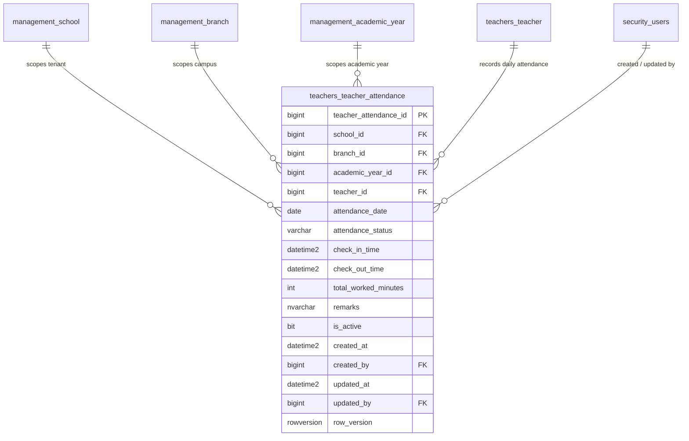

# Thinkigen School ERP - Teacher Daily Attendance Module (Audited Production Reference)

## 1. Executive Summary & Architecture Decision

The **Teacher Daily Attendance Module** (`teachers_schema`) provides daily attendance tracking, check-in/out timestamps, working duration metrics, and administrative remarks for teaching staff across multi-tenant schools and branches.

### Thinkigen Core Architecture Principle (Strict Separation of Concerns):
- **Microsoft SQL Server / Azure SQL Database (`teachers_schema.teacher_attendance`)**: Authoritative transactional system of record for tables, composite tenant relationships, natural unique constraints, status check constraints, nonclustered reporting indexes, and `rowversion` concurrency tokens.
- **FastAPI Application (`app/routers/teacher_attendance.py`, `app/services/teacher_attendance_service.py`)**: All business logic, check-in/out workflows, duration math (`total_worked_minutes = round((check_out_time - check_in_time).total_seconds() / 60)`), status determination (`PRESENT`, `ABSENT`, `HALF_DAY`), and transaction orchestration.
- **Zero SQL Triggers**: No triggers are deployed to the database. All business workflows are managed by FastAPI backend services.
- **Zero Stored Procedures**: Direct parameterized queries and SQLModel / SQLAlchemy transactions manage persistence.
- **Zero Database-Side Business Logic**: Business rules reside strictly in version-controlled Python code.

---

## 2. Master Relational Mapping

| Master Table | Primary Key | Column Data Types Verified | Candidate Key / Scope Constraint | Role in Attendance Architecture |
| :--- | :--- | :--- | :--- | :--- |
| `management_schema.school` | `school_id` | `BIGINT IDENTITY(1, 1)` | `PK_school` | Root tenant institution |
| `management_schema.branch` | `branch_id` | `BIGINT IDENTITY(1, 1)`, `school_id BIGINT` | `UQ_branch_school_scope (school_id, branch_id)` | Branch campus scoping |
| `management_schema.academic_year` | `academic_year_id` | `BIGINT IDENTITY(1, 1)`, `school_id BIGINT` | `UQ_academic_year_school_scope (school_id, academic_year_id)` | Academic calendar scoping |
| `teachers_schema.teacher` | `teacher_id` | `BIGINT IDENTITY(1, 1)`, `school_id BIGINT`, `branch_id BIGINT` | `PK_teacher (teacher_id)` | Authoritative faculty member (Global PK) |
| `security_schema.users` | `user_id` | `BIGINT IDENTITY(1, 1)` | `PK_users` | User identity for audit (`created_by`, `updated_by`) |

---

## 3. Entity-Relationship Architecture

---

## 4. Single Table Schema: `teachers_schema.teacher_attendance`

Migration 027 manages exclusively `teachers_schema.teacher_attendance` with exactly **17 columns**:

### Column Dictionary

| Column Name | Data Type | Nullability | Default | Business Purpose |
| :--- | :--- | :---: | :--- | :--- |
| `teacher_attendance_id` | `BIGINT IDENTITY(1,1)` | `NOT NULL` | - | Primary Key |
| `school_id` | `BIGINT` | `NOT NULL` | - | School tenant identifier |
| `branch_id` | `BIGINT` | `NOT NULL` | - | Branch campus identifier |
| `academic_year_id` | `BIGINT` | `NOT NULL` | - | Academic year session |
| `teacher_id` | `BIGINT` | `NOT NULL` | - | Faculty member identifier |
| `attendance_date` | `DATE` | `NOT NULL` | - | Calendar date of attendance |
| `attendance_status` | `VARCHAR(20)` | `NOT NULL` | - | `PRESENT`, `ABSENT`, `HALF_DAY`, `ON_LEAVE`, `WEEKLY_OFF`, `HOLIDAY` |
| `check_in_time` | `DATETIME2(0)` | `YES` | `NULL` | First physical/portal check-in |
| `check_out_time` | `DATETIME2(0)` | `YES` | `NULL` | Final physical/portal checkout |
| `total_worked_minutes`| `INT` | `YES` | `NULL` | Worked duration calculated by FastAPI |
| `remarks` | `NVARCHAR(500)` | `YES` | `NULL` | Operational notes or exception justification |
| `is_active` | `BIT` | `NOT NULL` | `1` | Record active status |
| `created_at` | `DATETIME2(0)` | `NOT NULL` | `SYSUTCDATETIME()` | Row insertion UTC timestamp |
| `created_by` | `BIGINT` | `NOT NULL` | - | User principal creating record |
| `updated_at` | `DATETIME2(0)` | `NOT NULL` | `SYSUTCDATETIME()` | Row update UTC timestamp |
| `updated_by` | `BIGINT` | `YES` | `NULL` | User principal updating record |
| `row_version` | `ROWVERSION` | `NOT NULL` | - | Concurrency token for optimistic locking |

---

## 5. Indexes on `teacher_attendance`

| Index Name | Type / Columns | Included Columns | Filter | Purpose |
| :--- | :--- | :--- | :--- | :--- |
| `PK_teacher_attendance` | `CLUSTERED (teacher_attendance_id)` | - | None | Primary clustered index |
| `UQ_teacher_attendance_teacher_date` | `UNIQUE NONCLUSTERED (teacher_id, attendance_date)` | - | None | Natural daily teacher key (1 record per teacher/day) |
| `IX_teacher_attendance_branch_daily` | `NONCLUSTERED (school_id, branch_id, attendance_date, attendance_status)` | `teacher_id, check_in_time, check_out_time, total_worked_minutes` | None | Dashboard and branch daily reports |
| `IX_teacher_attendance_teacher_history` | `NONCLUSTERED (teacher_id, attendance_date DESC)` | `attendance_status, check_in_time, check_out_time, total_worked_minutes` | None | Teacher history and monthly summaries |

---

## 6. Mock Data & Timetable / Leave Application Synchronization

The realistic mock seed script [`021_teacher_attendance_mock_data.sql`](file:///c:/Users/ACER/Downloads/THINKIGEN%20DATABASE/THINKIGEN%20DATABASE/database/seeds/021_teacher_attendance_mock_data.sql) generates daily attendance data correlated with:
1. **Master Timetable Periods (`management_schema.timetable_period`)**:
   - Faculty standard hours: `08:15` to `16:30` (arrival 15 mins prior to Period 1 at `08:30`).
   - Normal on-time, late arrivals (with highway traffic remarks), and approved early departures.
   - Dynamic synchronization with any additional scheduled timetable periods.
2. **Leave Approvals (`teachers_schema.teacher_leave_application`)**:
   - Approved full-day leaves (`ON_LEAVE` with `check_in_time = NULL`, `check_out_time = NULL`, `total_worked_minutes = NULL`).
   - Approved half-day leaves (`HALF_DAY` with partial shift worked hours, e.g., 255 or 240 minutes).
   - Rejected / cancelled leaves (`PRESENT` with normal teaching hours).
   - Pending unapproved leaves (`ABSENT`).
   - Sundays marked as `WEEKLY_OFF`.

